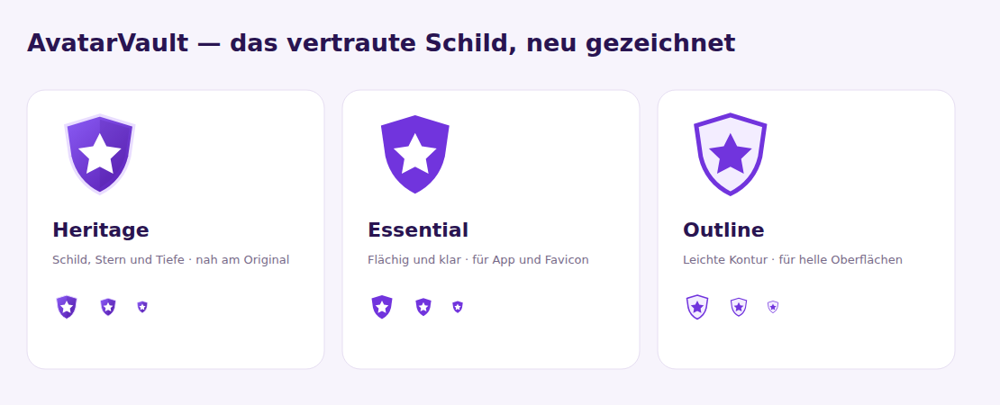

# AvatarVault


[](https://github.com/mapo-89/avatarvault/actions/workflows/ci.yml)
[](https://github.com/mapo-89/avatarvault/releases)
[](https://www.php.net/)
[](https://laravel.com/)
[](https://github.com/mapo-89/core-panel-monorepo)
[](https://github.com/mapo-89/laravel-avatar-manager)
[](LICENSE.md)
[](https://github.com/mapo-89/avatarvault/issues)
[](https://github.com/mapo-89/avatarvault/stargazers)
[](https://github.com/mapo-89/avatarvault/commits/main)

<a href="https://buymeacoffee.com/mapo"></a>

Selbst gehostete Avatare mit öffentlicher E-Mail-Hash-URL. Einmal hochladen,
überall einbinden und Profilbilder auf der eigenen Infrastruktur behalten.

[English documentation](README.md)

## Funktionen

- Avatar-Dashboard mit Upload, Vorschau, Ersetzen und Löschen.
- Öffentliche Gravatar-artige URLs über `md5(strtolower(trim($email)))`.
- Kopierbare Avatar-URL und HTML-Einbindung.
- CorePanel für Anmeldung, Profil, Zwei-Faktor-Sicherheit und Administration.
- Authentik-Anmeldung über CorePanels allgemeine OIDC-Anbindung.
- Avatar Manager v2 mit Spatie Media Library und geschütztem API-Upload.
- Deutsche und englische Oberfläche, mobile Ansichten und skalierbare SVGs.

## Voraussetzungen

| Komponente | Voraussetzung |
| --- | --- |
| PHP | 8.5+ mit Laravel-Erweiterungen, fileinfo, exif und Datenbanktreiber; GD für Tests |
| Framework | Laravel 13, CorePanel ab 1.6 |
| Avatar-Paket | `mapo-89/laravel-avatar-manager` 2.x |
| Frontend | Node.js 24+, npm, Vue 3, Inertia 3, PrimeVue, Tailwind 4 |
| Datenbank | MySQL oder PostgreSQL; Tests auch mit SQLite |
| Worker | Redis beim Betrieb von Horizon |

Das Avatar-Manager-Paket selbst unterstützt PHP ab 8.3. AvatarVault benötigt wegen
CorePanel PHP ab 8.5. Jetstream, Livewire und Sanctum werden durch den CorePanel-Stack
ersetzt. Die inkompatible Anwendungsumstellung gehört in einen Major-Release.

## Installation

```bash
git clone https://github.com/mapo-89/avatarvault.git
cd avatarvault
cp .env.example .env
composer install
php artisan key:generate
```

`APP_URL`, Datenbankzugang und Mailversand in `.env` konfigurieren. Danach:

```bash
php artisan migrate
php artisan core-panel:sync-access
php artisan passport:keys
php artisan storage:link
npm ci
npm run build
```

Der Webserver muss `public/` als Document Root verwenden. App-Schlüssel,
Datenbank und `storage/` dauerhaft speichern. In Produktion `APP_ENV=production`
und `APP_DEBUG=false` setzen.

Der öffentliche Hash-Endpunkt streamt über Laravel und benötigt selbst keinen
Storage-Symlink. CorePanels direkte Medien-URLs verwenden den Storage-Link.

### Erstes Administratorkonto

Ein normales Konto registrieren und Administratorrechte ausdrücklich vergeben:

```bash
php artisan core-panel:user:assign-super-admin admin@example.com
```

`admin@example.com` durch das gewünschte bestehende Konto ersetzen.
Bestehende Konten werden nicht automatisch befördert. Avatarverwaltung:
`/dashboard`; Profil und Sicherheit: `/profile` und `/profile/security`;
Administration: `/admin`.

### Lokale Entwicklung

```bash
php artisan serve
npm run dev
```

Bei konfigurierten Redis-Queues Horizon mit `php artisan horizon` starten.
`php artisan schedule:work` führt geplante CorePanel-Wartung aus.

## Konfiguration

| Variable | Standard | Zweck |
| --- | --- | --- |
| `APP_NAME` | `AvatarVault` | Name der Anwendung. |
| `APP_URL` | `http://localhost` | Basis für Avatar- und Medien-URLs. |
| `APP_LOCALE` | `de` im Beispiel | Anfängliche Oberflächensprache. |
| `AVATAR_DISK` | `public` | Dateisystem für Profilbilder und API-Uploads. |
| `AVATAR_API_KEY` | leer | Schlüssel für autorisierte Backend-Uploads. |
| `REGISTRATION_ENABLED` | `true` | Selbstregistrierung; auch in CorePanel einstellbar. |
| `EMAIL_VERIFICATION_ENABLED` | `false` | Optionale E-Mail-Verifikation; erst bei funktionierendem Mailversand aktivieren. |

CorePanel übernimmt Laufzeiteinstellungen und Rollen. Paketoberflächen bleiben
in `vendor`; Einstiegspunkte und AvatarVault-Seiten gehören der Anwendung.
Vor späteren CorePanel-Updater-Läufen eigene Anpassungen prüfen. Den
Neuinstallationsgenerator nicht über eine bestehende AvatarVault-Datenbank laufen lassen.

### Vertrauenswürdige Proxies

`bootstrap/trust_proxies.php` bleibt eingebunden. Nur tatsächlich vertrauenswürdige
Proxy-Adressen eintragen, beispielsweise:

```php
<?php
$middleware->trustProxies(['172.18.0.0/16']);
```

## Authentik / OIDC

Den exakten Issuer der Authentik-Anwendung aus deren Discovery-Dokument verwenden:

```dotenv
SOCIAL_OIDC_ENABLED=true
OIDC_ISSUER="https://auth.example.com/application/o/avatarvault/"
OIDC_CLIENT_ID="your-client-id"
OIDC_CLIENT_SECRET="your-client-secret"
OIDC_REDIRECT_URI="https://avatars.example.com/auth/oidc/callback"
```

Genau diese Redirect-URI in Authentik hinterlegen. Der Issuer enthält den
Anwendungs-Slug und ist nicht bloß die Server-Basisadresse. Zugangsdaten in `.env`
oder unter **Einstellungen → Authentifizierung** in CorePanel pflegen.
Nach Änderungen den Konfigurationscache leeren.

`/auth/authentik` leitet auf CorePanels OIDC-Anmeldung um. Bestehende Authentik-Subjects
werden mit unverändertem Subject und Benutzer-ID als Provider `oidc` nach
`social_accounts` übernommen. Dafür dieselbe Authentik-Anwendung und denselben
Issuer weiterverwenden. Alte `oidc_*`-Felder und Gruppen bleiben erhalten;
Gruppen-Claims vergeben keine automatischen Administratorrollen in CorePanel.
Die bisherige `AUTHENTIK_*`-Konfiguration durch `OIDC_*` ersetzen.

## Avatare einbinden und hochladen

```php
use Mapo89\LaravelAvatarManager\Facades\AvatarManager;

$url = AvatarManager::url('user@example.com');
```

```html

```

Hash-URLs sind öffentlich. MD5 anonymisiert keine E-Mail-Adressen und ist kein
Zugriffsschutz. Bei einer neuen E-Mail-Adresse ändert sich die URL. Verwaltete
Profilbilder haben Vorrang vor alten API-Uploads. Unbekannte Hashes liefern das
mitgelieferte Standardbild; ungültige Hash-Formate liefern `404`.

Backend-Upload ohne Benutzerregistrierung:

```bash
curl --request POST 'https://avatars.example.com/api/avatars/upload' \
  --header "X-API-KEY: $AVATAR_API_KEY" \
  --form 'email=user@example.com' \
  --form 'avatar=@profile.png'
```

Erlaubt sind JPEG, PNG, GIF und WebP bis 2 MiB. Antworten: `200` gespeichert,
`401` ungültiger Schlüssel, `409` verwaltetes Profilbild vorhanden,
`422` ungültige Eingabe. Schlüssel gehören nicht in Browser-Code.
Die Konto-API verwendet jetzt Passport; der separate Avatar-Upload per
`X-API-KEY` bleibt erhalten.

### Zusätzliche E-Mail-Adressen

Unter **Dashboard → E-Mail-Aliasse** lassen sich bis zu 20 zusätzliche Adressen
hinterlegen. Jede erhält einen Bestätigungslink, der 60 Minuten gültig ist. Öffne
ihn angemeldet mit dem Konto, das den Alias angelegt hat. Erst nach der
Bestätigung liefert die Adresse dasselbe Profilbild; ihre eigene Hash-URL lässt
sich dann im Dashboard kopieren.

Bildänderungen gelten für alle bestätigten Adressen. API-Uploads an einen
bestätigten Alias aktualisieren ebenfalls das Bild der Hauptadresse; der Schutz
verwalteter Profilbilder bleibt bestehen. Beim Entfernen eines Alias bleibt das
Profilbild erhalten. Aliasse dienen nicht als zusätzliche Anmeldenamen.
Bestehende Kontoadressen und bereits anderweitig bestätigte Aliasse sind gesperrt.
Der Mailversand muss auch bei deaktivierter Kontoverifizierung funktionieren.
Grenzen und Linklaufzeit stehen in `config/avatarvault.php`.

## Bestehende Installation umstellen

Zuerst Datenbank, `.env`, App-Schlüssel, Uploads und bisherigen Anwendungsstand
sichern. Datenbank, `APP_KEY` und Bild-Dateisystem beibehalten. Webzugriffe und
Queue-Worker während der Umstellung anhalten. Im aktualisierten Checkout:

```bash
composer install --no-dev --optimize-autoloader
npm ci
npm run build
php artisan migrate --force
php artisan avatarvault:import-legacy-avatars
php artisan core-panel:sync-access
php artisan passport:keys
php artisan storage:link
php artisan optimize:clear
```

Importergebnis vor Wiederaufnahme des Betriebs prüfen. Fehlende Dateien oder
Speicherfehler beheben und den Import wiederholen. Er ist idempotent und meldet
ungelöste Bilder mit einem Fehlerstatus. Kein `migrate:fresh` verwenden.

- Numerische IDs, Passwort-Hashes, E-Mails und Migrationshistorie bleiben erhalten.
- Vor- und Nachname werden für CorePanel ergänzt; die bisherige `name`-Spalte bleibt.
- Gezielte Host-Migrationen erhalten numerische Fremdschlüssel in CorePanel/Passport.
- Der Bildimport kopiert Jetstream-Bilder in die Sammlung `avatars`, behält Originaldateien
  und entfernt alte Verweise erst nach erfolgreicher Übernahme.
- Authentik-Verknüpfungen werden wie oben beschrieben übernommen. Callback und
  Umgebungsvariablen vor Aktivierung der OIDC-Anmeldung aktualisieren.
- Alte Sanctum-Token bleiben gespeichert, authentifizieren aber nicht mehr.
  API-Clients benötigen neue Passport-Token; der Avatar-Upload-Schlüssel bleibt gültig.
- Zwei-Faktor-Secrets und Wiederherstellungscodes bleiben mit demselben App-Schlüssel nutzbar.

Die Installation der Abhängigkeiten migriert keine Produktionsdaten. Nach
Schemaänderungen benötigt ein Rollback die passende Datenbank-/Dateisicherung
und den vorherigen Checkout; erhaltene Altdateien ersetzen kein Backup.

## Logo und Icon

**Heritage ist die gewählte AvatarVault-Bildmarke** für Logo und App-Icon.
Das Browser-Favicon verwendet die flächige Variante **Essential**, die in kleinen
Größen klar erkennbar bleibt. Violettes Schild und weißer Stern bleiben erhalten.
Der Entwurfsvergleich und die alternativen Studien bleiben in der
[gemeinsamen Vorschau](public/images/brand/concepts.svg) verfügbar:

1. [Heritage](public/images/brand/heritage.svg): mit Tiefe und besonders nah am Original.
2. [Essential](public/images/brand/essential.svg): flächige Variante für App und Favicon.
3. [Outline](public/images/brand/outline.svg): leichte Kontur für helle Oberflächen.



[Wortmarke](public/images/brand/logo.svg) · [App-Icon](public/images/brand/icon.svg) · [Favicon](public/images/brand/essential.svg).
Root-View, Favicon und geteiltes Logo werden über Host-Overrides angepasst;
CorePanel-Komponenten bleiben im Paket.

## Entwicklung und Prüfungen

```bash
composer qa
npm run qa
```

PHP-Tests verwenden `.env.testing` und eine isolierte SQLite-In-Memory-Datenbank.
Die CI prüft Migrationen zusätzlich mit PostgreSQL. Frontend-Prüfungen enthalten
ESLint, Prettier, TypeScript, Build und Dependency-Audit.

## Releases

Der [gemeinsame Release-Leitfaden](.release/README.md) beschreibt Commit-Regeln,
Dependency-Updates und den Ablauf `main → feature/* → release/X.Y.Z → main`.
Direkte kategorisierte Commits auf dem Release-Branch sind ebenfalls möglich.
Release-PRs bleiben bis zur erfolgreichen CI für den exakten Implementierungsstand
Draft. Anschließend einmal gesammelt vorbereiten und erneut prüfen. Normale
Commits oder Pushes veröffentlichen nichts; bestehende Tags bleiben unverändert.

## Sicherheit, Mitwirkende und Lizenz

Sicherheitsprobleme vertraulich an [info@postler.de](mailto:info@postler.de) melden.
Betreuung durch [Manuel Postler](https://github.com/mapo-89).
Veröffentlicht unter der [MIT-Lizenz](LICENSE.md).
