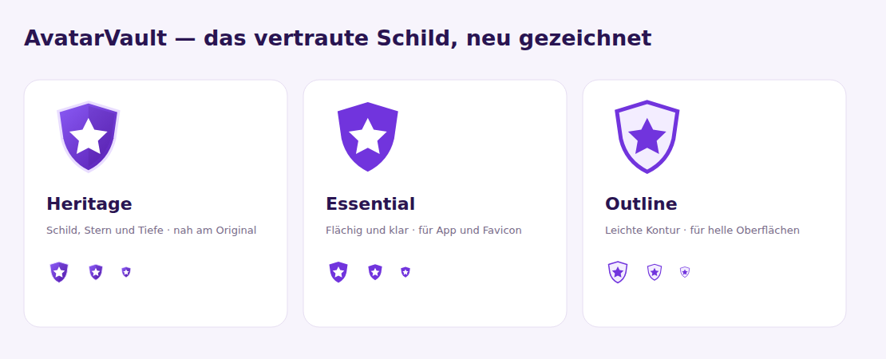

<p align="center">
  
</p>

# AvatarVault

[](https://github.com/mapo-89/avatarvault/actions/workflows/ci.yml)
[](https://github.com/mapo-89/avatarvault/releases)
[](https://www.php.net/)
[](https://laravel.com/)
[](https://github.com/mapo-89/core-panel-monorepo)
[](https://github.com/mapo-89/laravel-avatar-manager)
[](LICENSE.md)
[](https://github.com/mapo-89/avatarvault/issues)
[](https://github.com/mapo-89/avatarvault/stargazers)
[](https://github.com/mapo-89/avatarvault/commits/main)

<a href="https://buymeacoffee.com/mapo"></a>

Self-hosted avatars with a public email-hash URL. Upload once, embed anywhere,
and keep your profile pictures on your own infrastructure.

[Deutsche Dokumentation](README.de.md)

## Features

- Avatar dashboard with upload, preview, replacement and deletion.
- Public Gravatar-style URLs based on `md5(strtolower(trim($email)))`.
- Copyable avatar URL and HTML snippet.
- CorePanel authentication, profile settings, two-factor security and administration.
- Authentik login through CorePanel's provider-neutral OIDC integration.
- Avatar Manager v2 with Spatie Media Library and API-key-protected uploads.
- German and English UI, responsive layouts and scalable SVG branding.

## Requirements

| Component | Requirement |
| --- | --- |
| PHP | 8.5+ with Laravel's required extensions, fileinfo, exif and a database driver; GD for tests |
| Framework | Laravel 13, CorePanel 1.6+ |
| Avatar package | `mapo-89/laravel-avatar-manager` 2.x |
| Frontend | Node.js 24+, npm, Vue 3, Inertia 3, PrimeVue, Tailwind 4 |
| Database | MySQL or PostgreSQL; tests also use SQLite |
| Workers | Redis when running Horizon |

The Avatar Manager package itself supports PHP 8.3+; AvatarVault requires PHP 8.5
because it uses CorePanel. Jetstream, Livewire and Sanctum are replaced by the
CorePanel stack. This is a breaking application migration, intended for a major release.

## Installation

```bash
git clone https://github.com/mapo-89/avatarvault.git
cd avatarvault
cp .env.example .env
composer install
php artisan key:generate
```

Configure `APP_URL`, database access and mail delivery in `.env`, then run:

```bash
php artisan migrate
php artisan core-panel:sync-access
php artisan passport:keys
php artisan storage:link
npm ci
npm run build
```

The public document root must point at `public/`. Store the application key,
database and `storage/` persistently. Set `APP_ENV=production` and
`APP_DEBUG=false` for production.

The public hash endpoint streams images through Laravel and needs no storage
symlink itself; CorePanel's direct media URLs use the storage link.

### First administrator

Register a normal account, then grant administration explicitly:

```bash
php artisan core-panel:user:assign-super-admin admin@example.com
```

Replace `admin@example.com` with the intended existing account. Existing
users are never automatically promoted. Normal avatar management is at
`/dashboard`, profile and security at `/profile` and `/profile/security`, and
administration at `/admin`.

### Local development

```bash
php artisan serve
npm run dev
```

Run Horizon separately with `php artisan horizon` when Redis-backed queues are
configured. `php artisan schedule:work` runs scheduled CorePanel maintenance.

## Configuration

| Variable | Default | Purpose |
| --- | --- | --- |
| `APP_NAME` | `AvatarVault` | Application identity. |
| `APP_URL` | `http://localhost` | Base URL for generated avatar and media links. |
| `APP_LOCALE` | `de` in the example | Initial interface language. |
| `AVATAR_DISK` | `public` | Storage for managed profile images and API uploads. |
| `AVATAR_API_KEY` | empty | Enables authorized backend uploads when set. |
| `REGISTRATION_ENABLED` | `true` | Allows self-registration; also configurable in CorePanel. |
| `EMAIL_VERIFICATION_ENABLED` | `false` | Optional email verification; configure working mail before enabling. |

CorePanel provides runtime settings and role management. Keep package UI assets
in `vendor`; the application owns its entrypoints and AvatarVault pages. For
future package updates, review host changes before running the CorePanel updater.
Do not run the fresh-install generator over an existing AvatarVault database.

### Trusted proxies

The existing `bootstrap/trust_proxies.php` hook remains active. Add only your
trusted proxy addresses there, for example:

```php
<?php
$middleware->trustProxies(['172.18.0.0/16']);
```

## Authentik / OIDC

Use the application's exact issuer from Authentik's discovery document:

```dotenv
SOCIAL_OIDC_ENABLED=true
OIDC_ISSUER="https://auth.example.com/application/o/avatarvault/"
OIDC_CLIENT_ID="your-client-id"
OIDC_CLIENT_SECRET="your-client-secret"
OIDC_REDIRECT_URI="https://avatars.example.com/auth/oidc/callback"
```

Register that exact redirect URI in Authentik. The issuer includes the application
slug and differs from the Authentik server's base URL. Enter credentials in `.env`
or CorePanel's **Settings → Authentication**. Clear cached configuration after changes.

The old `/auth/authentik` entrypoint redirects to CorePanel's OIDC login. Existing
Authentik subjects are copied into `social_accounts` as provider `oidc`, retaining
the original subject and user ID. Configure the same Authentik application/issuer
to retain that identity. Legacy `oidc_*` fields and group claims remain in the
database; group claims do not automatically grant CorePanel administration roles.
Replace the previous `AUTHENTIK_*` environment configuration with `OIDC_*`.

## Embed and upload avatars

```php
use Mapo89\LaravelAvatarManager\Facades\AvatarManager;

$url = AvatarManager::url('user@example.com');
```

```html

```

The endpoint accepts MD5 (32 hexadecimal characters) and SHA-256 (64 hexadecimal
characters), including uppercase hashes. Hash the trimmed, lowercase email:

```php
$hash = hash('sha256', strtolower(trim('user@example.com')));
$url = url('/avatar/'.$hash);
```

Both formats resolve the same profile picture for primary addresses and verified
aliases. New API uploads also support both formats without an account. Re-upload
older API-only images to enable SHA-256 when their email has no account; the
original email cannot be recovered from an old MD5 filename.

Hash URLs are public identifiers. Hashing does not anonymize email addresses and
provides no access control. Changing the account email changes the avatar URL.
Managed profile images take precedence over earlier API uploads; unknown hashes
return the bundled default image. Invalid hash formats return `404`.

Backend API upload, without creating a user:

```bash
curl --request POST 'https://avatars.example.com/api/avatars/upload' \
  --header "X-API-KEY: $AVATAR_API_KEY" \
  --form 'email=user@example.com' \
  --form 'avatar=@profile.png'
```

JPEG, PNG, GIF and WebP up to 2 MiB are accepted. Responses: `200` stored, `401`
invalid key, `409` existing managed image, `422` invalid input. Keep API keys out
of browser code. Account API authentication now uses Passport; the separate
`X-API-KEY` avatar endpoint is unchanged.

### Additional email addresses

Add up to 20 email aliases under **Dashboard → Email aliases**. Each address
receives a confirmation link valid for 60 minutes. Open it while signed into the
account that added the alias. Only confirmed aliases serve the account's avatar;
their individual hash URLs are available to copy in the dashboard.

All confirmed addresses follow subsequent picture changes. API uploads to a
confirmed alias also update the primary address's avatar, subject to the same
managed-image protection. Removing an alias removes that association without
deleting the profile picture. Aliases do not provide additional sign-in names.
An existing account address or another account's confirmed alias cannot be used.
Working mail delivery is required even when account email verification is disabled.
Limits and link lifetime are configured in `config/avatarvault.php`.

## Migrate an existing installation

Back up the database, `.env`, application key, uploaded files and the previous
application checkout first. Keep the same database, `APP_KEY` and storage disk.
Stop web traffic and queue workers during the migration. In the updated checkout:

```bash
composer install --no-dev --optimize-autoloader
npm ci
npm run build
php artisan migrate --force
php artisan avatarvault:import-legacy-avatars
php artisan core-panel:sync-access
php artisan passport:keys
php artisan storage:link
php artisan optimize:clear
```

Review the import result before resuming traffic and workers. Run the import
again after resolving missing files or storage errors; it is idempotent and
returns a nonzero status for unresolved images. Do not use `migrate:fresh`.

- Numeric user IDs, password hashes, emails and existing migration history remain.
- Name fields are backfilled for CorePanel; the original `name` column stays.
- Host migration overrides retain numeric foreign keys in CorePanel/Passport tables.
- The image importer copies existing Jetstream pictures into `avatars`, retains
  the original files, and clears legacy references only after successful import.
- Existing Authentik identities are migrated as described above. Update the
  provider callback and environment settings before enabling OIDC.
- Existing Sanctum token records are retained but no longer authenticate. Issue
  replacement Passport tokens to API clients. The avatar upload key remains valid.
- Existing two-factor secrets and recovery codes remain usable with the same app key.

Production data is not migrated by dependency installation alone. Rollback after
schema changes requires the matching database/file backup and previous checkout;
retained legacy files are not a substitute for that backup.

## Branding

**Heritage is the selected AvatarVault identity** for the wordmark and app icon.
The browser favicon uses the flat **Essential** variant for clarity at small sizes.
Both retain the original purple shield and white star. The design
comparison and alternative studies remain available in
[the comparison](public/images/brand/concepts.svg):

1. [Heritage](public/images/brand/heritage.svg): depth and the closest relation to the original.
2. [Essential](public/images/brand/essential.svg): a flat version for apps and favicons.
3. [Outline](public/images/brand/outline.svg): a light contour for bright surfaces.



[Wordmark](public/images/brand/logo.svg) · [App icon](public/images/brand/icon.svg) · [Favicon](public/images/brand/essential.svg).
The host overrides the root view/favicon and shared logo; CorePanel components
remain vendor-managed.

## Development and checks

```bash
composer qa
npm run qa
```

PHP tests use the isolated `.env.testing` configuration and an in-memory SQLite
database. CI also checks migration compatibility against PostgreSQL. Frontend
checks include ESLint, Prettier, TypeScript, build and dependency audit.

## Security, credits and license

Report security issues privately to [info@postler.de](mailto:info@postler.de).
Maintained by [Manuel Postler](https://github.com/mapo-89).
Licensed under the [MIT License](LICENSE.md).

## Shared release workflow

The application version is stored in `config/app-version.json` and appears in
the version badge and system information. The initial working version is
`1.0.0-dev`. After the required CI succeeds, the release branch's `prepare` step
sets the release, display and image versions to `1.0.0` (or the branch version)
and clears commit identity fields. Publication validates this metadata against
the prepared release merge before creating its `vX.Y.Z` tag. Ordinary commits
do not change the version.

Commit types, explicit release triggers, and grouped release notes follow the
[shared release standard](.release/README.md). Ordinary pushes do not publish
production versions. Existing builds, artifact handling, and deployment approvals
remain project-specific.

## Release branch workflow

Feature branches start from main and are squash-merged into release/X.Y.Z.
Alternatively or additionally, commit directly on release/X.Y.Z; these commits
remain separate and do not require squashing. Ordinary commits do not rewrite
version metadata or CHANGELOG.md. Once the release scope is complete, run
`node .release/branches.mjs prepare` once to collect all changes on that branch.
If more commits follow, refresh preparation and checks together at finalization,
rather than after each commit. Then merge the prepared release into main
with --no-ff and subject `🚀 Release: X.Y.Z`. Publish the tested merge commit.
The prepared changelog supplies the published release notes; no post-release
changelog commit is created. See [.release/README.md](.release/README.md).

## Automated dependency maintenance

Dependabot proposes weekly dependency updates. Reviewed updates are retargeted to
the active release branch, tested, and squash-merged through their PRs.
See [.release/README.md](.release/README.md#dependency-updates) for the policy
and activation requirements. Dependency PRs never authorize a release.
